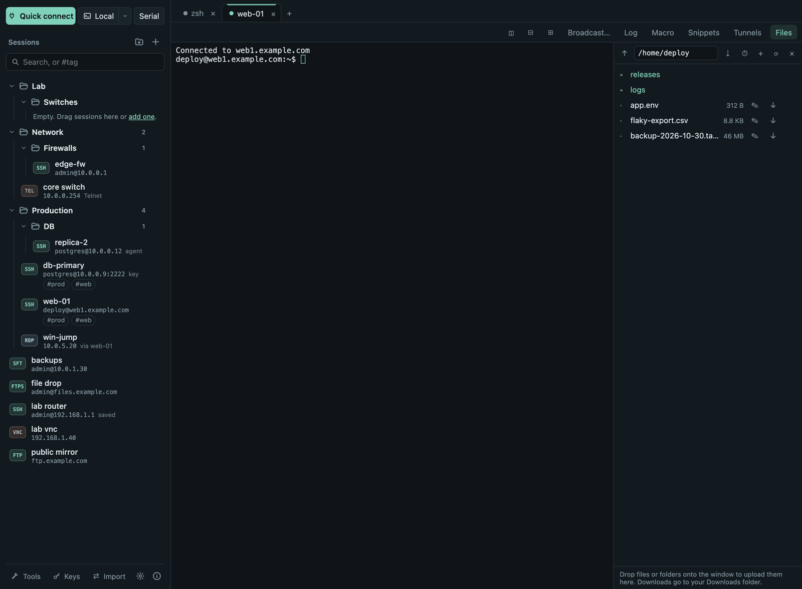
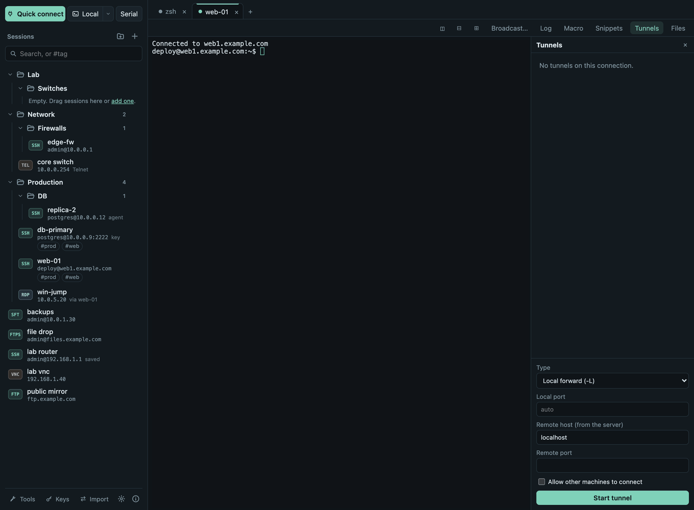
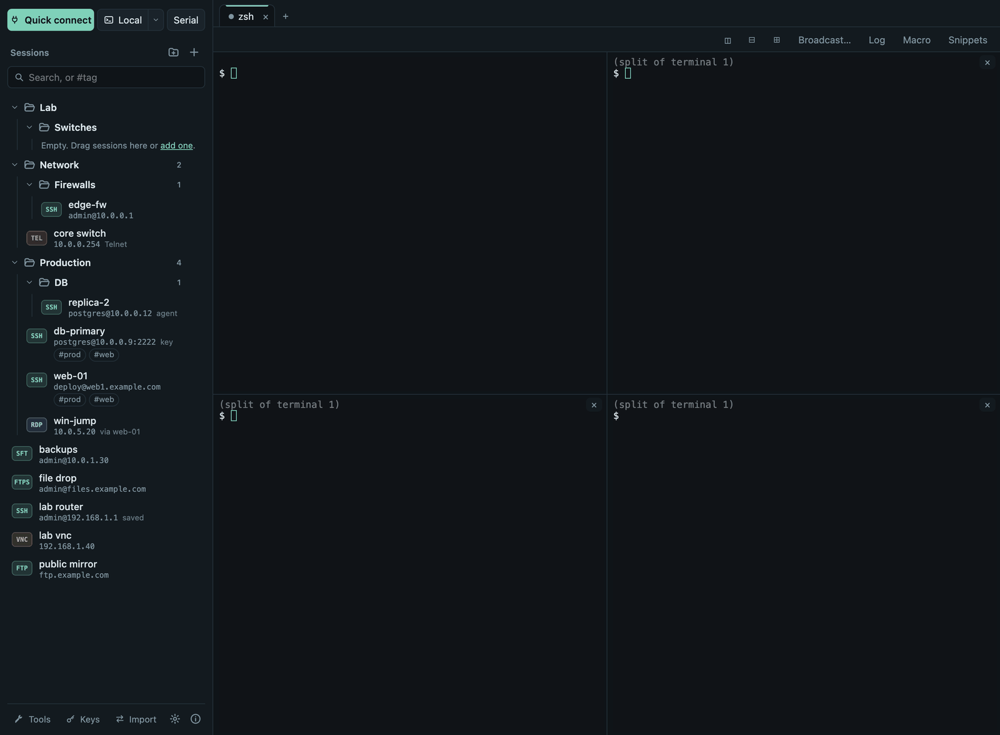

# Termalith

**One workspace. Every connection.** A free, open-source remote
administration app for macOS, Windows and Linux: SSH and Mosh terminals,
SFTP/FTP/FTPS, RDP and VNC, tunnels, serial and Telnet consoles and network
tools in one window.

[](https://github.com/mehaskari/Termalith/releases/latest)
[](LICENSE)
[](https://github.com/mehaskari/Termalith/releases/latest)
[](https://github.com/mehaskari/Termalith/actions/workflows/ci.yml)

**[⬇ Download](https://mehaskari.github.io/Termalith/#install)** ·
**[User guide](https://mehaskari.github.io/Termalith/guide/)** ·
**[Website](https://mehaskari.github.io/Termalith/)** ·
**[Changelog](https://mehaskari.github.io/Termalith/changelog/)**



## Why Termalith

- **Free for any use.** MIT licensed: no paid edition, no account, no
  session limits, at home or at work.
- **The same app on every system.** macOS (Apple Silicon and Intel),
  Windows (x64 and ARM64) and Linux (x64 and ARM64), one feature set, every
  build tested in CI.
- **Careful with your keys.** Passwords only in the system keychain
  (optionally sealed with a master password), strict host keys, pinned RDP
  and FTPS certificates, no telemetry.
- **Easy to switch to.** Imports MobaXterm `.mxtsessions` exports and
  `~/.ssh/config`.

## Download

The [download page](https://mehaskari.github.io/Termalith/#install) picks
the right file for your computer. Or take it from the
[latest release](https://github.com/mehaskari/Termalith/releases/latest)
under **Assets**:

| Your computer | File |
|---|---|
| Mac with Apple Silicon (M1–M4) | `Termalith_<version>_aarch64.dmg` |
| Mac with Intel | `Termalith_<version>_x64.dmg` |
| Windows 10/11 (x64) | `Termalith_<version>_x64-setup.exe` (or `.msi`) |
| Windows on ARM | `Termalith_<version>_arm64-setup.exe` (or `.msi`) |
| Linux x64: Ubuntu, Debian, Mint / any distribution | `…_amd64.deb` / `…_amd64.AppImage` |
| Linux ARM64 | `…_arm64.deb` / `…_aarch64.AppImage` |

The installers are **not code-signed** with a paid certificate yet:

- **macOS:** open the app once, then **System Settings → Privacy &
  Security → Open Anyway** (macOS 14 and older: right-click → **Open**).
- **Windows:** if SmartScreen warns, **More info → Run anyway**.
- **Linux:** `sudo apt install ./Termalith_*_amd64.deb`, or
  `chmod +x` the AppImage and run it.

Verify a download with the release's `SHA256SUMS.txt`. Requirements and
details: [Download and install](https://mehaskari.github.io/Termalith/guide/install/).

## Quick start

1. Click **+** next to *Sessions*, choose **SSH terminal**, enter host and
   user name, **Save**.
2. Click the session, confirm the server's host key once, log in (tick
   *Save in the system keychain* to skip it next time).
3. Use **Files** for SFTP and **Tunnels** for port forwarding on the tab.

Step by step with screenshots:
[Your first connection](https://mehaskari.github.io/Termalith/guide/first-steps/).

## Features

**Terminals** — local shells (zsh, bash, fish, PowerShell, cmd, Git Bash,
WSL) in tabs and up to 2×2 split panes; broadcast typing to several
terminals; snippets with `{{variables}}`; macros; session logs; find;
keyword colors; color schemes and per-session fonts and colors; command
palette.
[Guide](https://mehaskari.github.io/Termalith/guide/terminals/)

**SSH** — password, private key, ssh-agent and one-time codes; strict host
keys; jump hosts; SOCKS5/HTTP proxy; tunnels (`-L`, `-R`, `-D`); X11 and
agent forwarding (opt-in); automatic reconnect; Mosh; SSH key manager;
optional server monitor (CPU, memory, disk, network).
[Guide](https://mehaskari.github.io/Termalith/guide/ssh/)

**Files** — SFTP panel next to the terminal or as its own tab; FTP and FTPS
(certificate pinned); drag-and-drop upload of files and folders; transfer
queue with retry; edit remote files with conflict detection; side-by-side
compare; the panel can follow the terminal's folder.
[Guide](https://mehaskari.github.io/Termalith/guide/files/)

**Remote desktop** — RDP and VNC inside a tab (resizes with it, sharp on
Retina, text clipboard both ways) or in your installed client, optionally
through an SSH tunnel; RDP certificates checked like SSH host keys.
[Guide](https://mehaskari.github.io/Termalith/guide/remote-desktop/)

**And** — serial consoles, Telnet (through a jump host if you like), ping,
traceroute, port check and scan, DNS lookup, subnet calculator,
Wake-on-LAN, built-in TFTP, HTTP and FTP file servers; folders, favorites, tags and search; import from MobaXterm and
`~/.ssh/config`; master password; portable mode on a USB stick; keyboard
navigation and screen-reader labels.
[All topics](https://mehaskari.github.io/Termalith/guide/)

<table>
<tr>
<td></td>
<td></td>
</tr>
<tr>
<td align="center">Tunnels on an SSH tab</td>
<td align="center">Four panes in one tab</td>
</tr>
</table>

**Not yet:** code-signed installers, automatic updates, sound and file
clipboard in embedded RDP, a built-in X server on Windows. Coming from
MobaXterm? See [what maps where](https://mehaskari.github.io/Termalith/guide/mobaxterm/).

## Privacy and security

Termalith connects only to the hosts you choose. No telemetry, no account,
no automatic downloads; crash reports stay on your computer until you
decide to share one. The interface cannot run commands on your computer,
secrets never appear in logs or on command lines, tunnels listen on
loopback by default, and agent and X11 forwarding are opt-in. Details:
[Security](https://mehaskari.github.io/Termalith/security/).

Found a vulnerability? Please report it privately through GitHub's
**Report a vulnerability** (Security tab), not in a public issue.

## Build from source

Requirements: Git, Rust (the version in `rust-toolchain.toml`), Node.js 24
with Corepack, and the [Tauri prerequisites](https://tauri.app/start/prerequisites/)
for your system (on Linux: the WebKitGTK 4.1 development packages).

```bash
git clone https://github.com/mehaskari/Termalith.git && cd Termalith
corepack pnpm install --frozen-lockfile
corepack pnpm dev                                        # run the app
cargo test --workspace                                   # Rust tests
corepack pnpm test                                       # frontend tests
corepack pnpm --filter @termalith/desktop tauri build   # installers for this system
```

A UI preview without the Rust backend:
`corepack pnpm --filter @termalith/desktop dev`, then open
`http://localhost:1420/mock.html`. More:
[Building and releasing](https://mehaskari.github.io/Termalith/releasing/).

## Contributing

Bug reports, ideas and pull requests are welcome in
[Issues](https://github.com/mehaskari/Termalith/issues). Pull requests run
the full CI (formatting, Clippy, tests on six platforms, real-server tests,
license and advisory checks, CodeQL) and must keep the user guide and
changelog current; see
[Keeping the documentation current](https://mehaskari.github.io/Termalith/releasing/#keeping-the-documentation-current).

## License

[MIT](LICENSE). Third-party components and their licenses:
[website/docs/third-party.md](website/docs/third-party.md). "Termalith" is a
working name; it has not been checked for trademarks.
