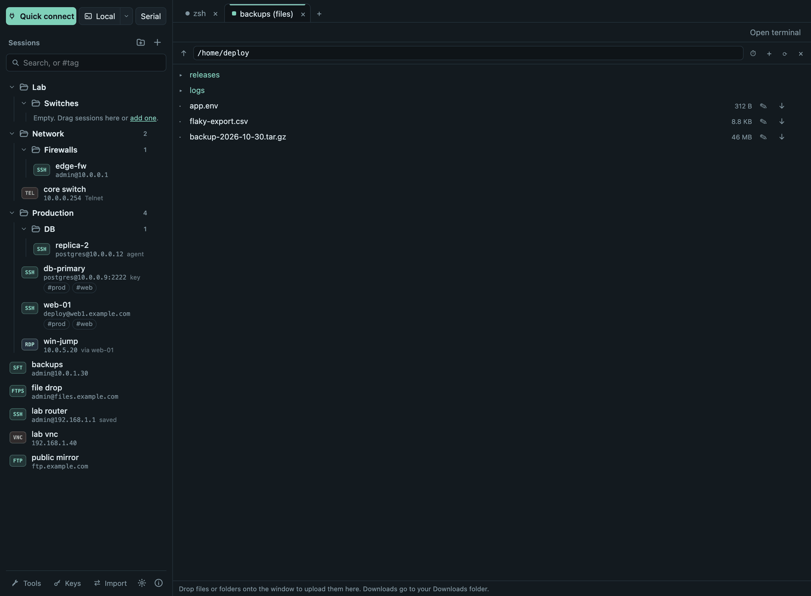

# Files

## Ways to open files

- **Files** on an SSH tab's toolbar opens the server's files next to the
  terminal, over the same connection.
- **⇅** on an SSH session row opens a **file-browser tab** without a shell.
  **Open terminal** adds a shell on the same connection later.
- A session with **Files only (SFTP, no terminal)** always opens the file
  browser.
- **FTPS** and **FTP** sessions open the same file browser.

## Moving files

- **Upload:** drop files or whole folders onto the window (the panel is
  outlined while you drag). A folder is uploaded with everything in it as
  one transfer, up to 10,000 entries; symbolic links are not followed, and a
  folder of the same name on the server is never merged or overwritten.
- **Download:** **↓** on a file saves it to your Downloads folder. For a
  folder, choose **⋯ → Download folder**: it is saved with everything in
  it (symbolic links are skipped), over SFTP, FTP and FTPS alike. Files
  start arriving at once; the transfer shows how much has arrived so far
  (the folder's total size is not known in advance). If a folder of that
  name is already in Downloads, the new one gets a number; **↻** after a
  failure keeps the files already downloaded.
- Up to three transfers run at once. Connection errors are retried
  automatically; a failed transfer has **Retry**.
- **Pause and resume downloads:** **⏸** pauses a running download and
  **▶** continues it where it stopped, over SFTP, FTP and FTPS (also for
  folders). Automatic retries and **Retry** after a dropped connection
  continue the same way. If the file changed on the server in the
  meantime, it is downloaded again from the start. **×** on a paused
  download discards the part already downloaded. Paused downloads last
  until Termalith is closed.
- **⏱ Transfer history** lists recent transfers of all connections (the
  last 500) with their outcome; **Clear** empties it. Only names, paths and
  sizes are kept, never file contents.

## Managing files

- **+** creates a folder; the row menu (⋯) has **Rename** and **Delete**
  (files and empty folders; there is no recursive delete, by design).
- Type a path into the path field, or use **↑** (or
  <kbd>Alt</kbd>+<kbd>↑</kbd>, <kbd>Backspace</kbd>) for the parent folder.

## Editing and comparing

- **✎** opens a text file (UTF-8, up to 2 MiB) in an editor tab.
  <kbd>Cmd</kbd>/<kbd>Ctrl</kbd>+<kbd>S</kbd> saves it back with its
  permissions. If someone changed the file on the server meanwhile, the save
  is refused and you choose to reload or overwrite.
- **Compare…** in a file's menu, then **Compare with …** on a second file,
  shows both side by side with the differences highlighted.

## Follow the terminal's folder

The **⇣** button in the Files panel of an SSH tab makes the panel follow
the terminal's current folder. Shells that report their folder work at once;
for others Termalith offers to type one line into the terminal so that bash
or zsh reports it until the shell exits. Nothing on the server is changed.

## FTP and FTPS

- **FTPS** uses explicit TLS on the FTP port. You check the server's
  certificate once, as for RDP; the connection fails if the certificate
  changes unnoticed or the server offers no TLS.
- **FTP** is not encrypted: passwords and files can be read on the network.
  Prefer SFTP or FTPS.
- Leave the user name empty for anonymous login.
- Both connect directly: no jump host, and they refuse to connect while a
  proxy is set in Settings. Implicit FTPS (port 990) is not supported.
