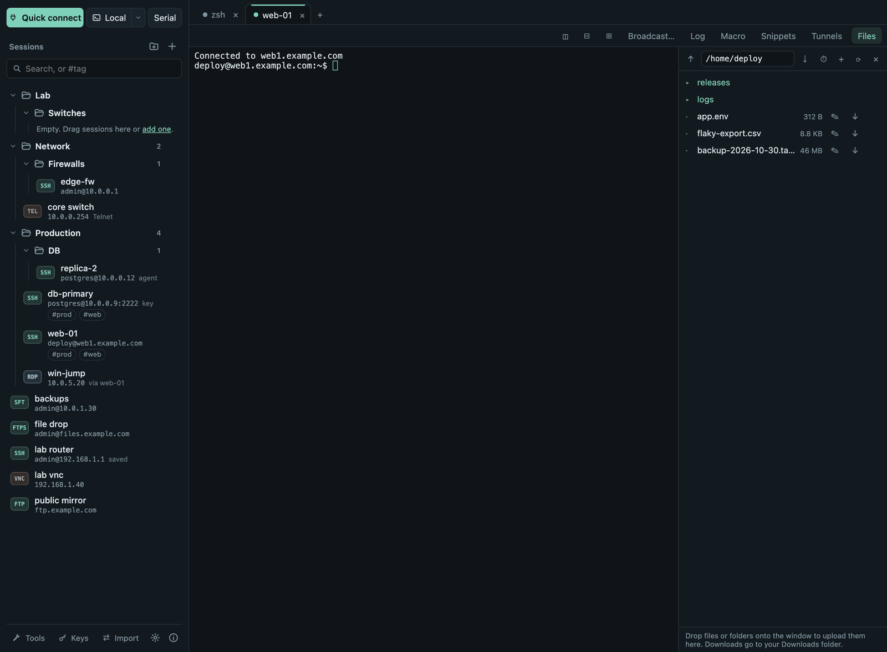
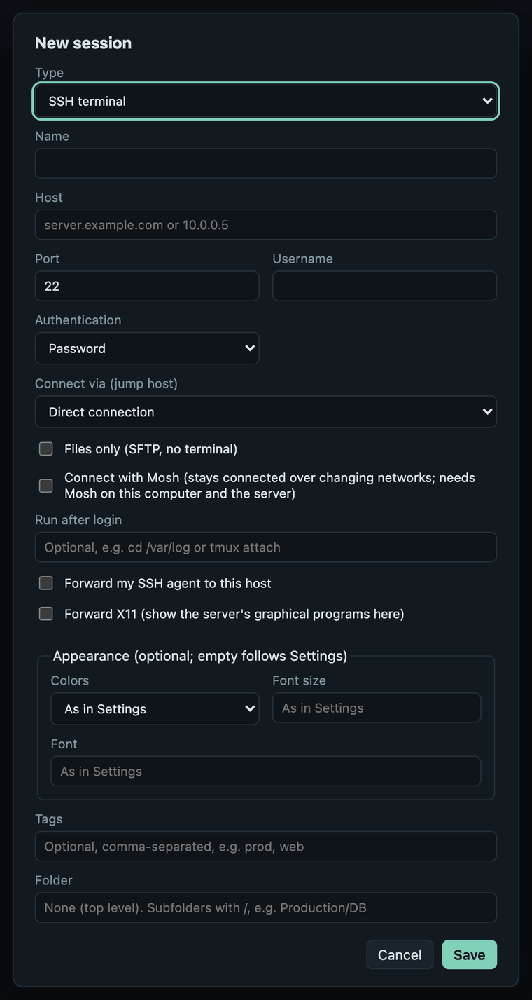
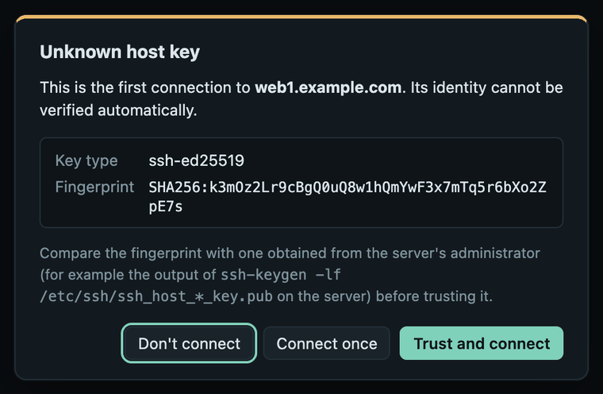
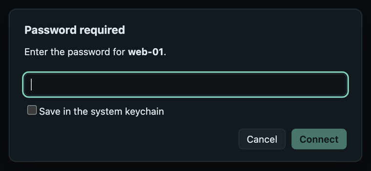

# Your first connection

This walk-through saves an SSH server, connects to it and opens its files.
It takes about two minutes.

## 1. The window

- **Left, top:** **Quick connect** (connect without saving), **Local** (a
  terminal on this computer; the ▾ picks a shell) and **Serial**.
- **Left, middle:** your saved sessions as a folder tree, with search.
- **Left, bottom:** **Tools** (network tools), **Keys** (SSH key manager),
  **Import** (import and export sessions), ☀ ([Settings](settings.md)) and ⓘ
  (About, update check).
- **Right:** your tabs. Every connection opens in a tab. Above a terminal
  is its toolbar: split, broadcast, log, macro, snippets and, for SSH tabs,
  **Tunnels** and **Files**.

## 2. Save a server

Click **+** next to *Sessions*.

{ width="440" }

1. **Type:** *SSH terminal* (the other types are RDP, VNC, Telnet, FTPS and
   FTP).
2. **Name:** anything you like, e.g. `web-01`.
3. **Host** and **Port:** the server's name or IP address; the port is 22
   for SSH unless your server uses another one.
4. **Username:** your account on the server.
5. **Authentication:** *Password*, *Private key file* (enter its full path, e.g.
   `/Users/you/.ssh/id_ed25519`) or *SSH agent*. See [SSH → Logging in](ssh.md#logging-in).
6. Optional: a **Folder** (`Production/Web` makes nested folders) and
   **Tags** (`prod, web`).
7. **Save.** The session appears in the list.

Everything else in the dialog is optional and explained in [SSH](ssh.md)
and [Sessions](sessions.md).

## 3. Connect and confirm the host key

Click the session. The first time you connect to a server, Termalith shows
its **host key fingerprint**:

{ width="440" }

A fingerprint is the server's identity. If you can, compare it with the one
your administrator gives you (`ssh-keygen -lf /etc/ssh/ssh_host_ed25519_key.pub`
on the server). Then choose:

- **Trust and connect:** remembered; you will not be asked again.
- **Connect once:** connects now and asks again next time.
- **Don't connect.**

If you already used the server with OpenSSH, Termalith trusts the keys in
your `~/.ssh/known_hosts` and does not ask.

!!! warning "If Termalith says the host key changed"
    It refuses to connect. This happens when a server is reinstalled, but it
    can also mean someone is intercepting the connection. Check with the
    server's administrator before you use **Remove recorded key…**.

## 4. Log in

For a password session, Termalith asks for the password:

{ width="440" }

Tick **Save in the system keychain** to log in without typing it next time.
It is saved only after the login worked, in your system's keychain (macOS
Keychain, Windows Credential Manager or the Secret Service on Linux), never
in Termalith's own files. Servers that ask for a one-time code from an
authenticator app show that question in the same way.

You now have a terminal on the server.

## 5. Open files and tunnels

- **Files** on the toolbar opens the server's files next to the terminal.
  Drop files or folders onto the window to upload; click **↓** to download
  to your Downloads folder. See [Files](files.md).
- **Tunnels** forwards ports through the connection, like `ssh -L`, `-R`
  and `-D`. See [SSH → Tunnels](ssh.md#tunnels).

## Next steps

- Bring in your existing sessions:
  [Import from MobaXterm or `~/.ssh/config`](sessions.md#import-and-export).
- Organize them with folders, favorites and tags: [Sessions](sessions.md).
- Work in several servers at once: [Terminals](terminals.md).
- Protect saved passwords with a master password:
  [Passwords and your data](passwords-and-data.md#master-password).
