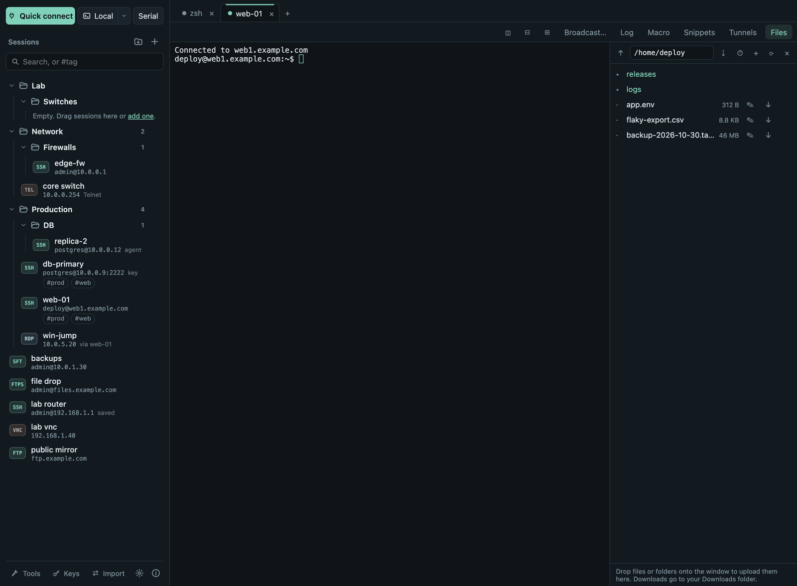

# User Guide

Termalith keeps your servers, network devices and remote desktops in one
window: saved sessions on the left, tabs on the right. It is free and open
source (MIT) and works the same on macOS, Windows and Linux.

## Start here

1. **[Download and install](install.md)**: pick the right file for your
   system and get past the first-launch warning.
2. **[Your first connection](first-steps.md)**: save a server, confirm its
   host key, log in, open files.

## Everything Termalith does

| Topic | What you will find |
|---|---|
| [Sessions](sessions.md) | Saving connections, folders, favorites, tags, search, import from MobaXterm and `~/.ssh/config`, export |
| [SSH](ssh.md) | Passwords, keys, agent, one-time codes, host keys, jump hosts, proxies, tunnels, X11 and agent forwarding, Mosh, key manager, server monitor |
| [Terminals](terminals.md) | Tabs, split panes, broadcast typing, snippets, macros, logs, find, colors and fonts |
| [Files](files.md) | SFTP panel and file browser, FTP and FTPS, uploads and downloads, editing remote files, compare |
| [Remote desktop](remote-desktop.md) | RDP and VNC inside Termalith or in your own client, certificates, tunnels |
| [Serial, Telnet and network tools](serial-telnet-tools.md) | Consoles for devices, ping, traceroute, port scan, DNS, subnet calculator, Wake-on-LAN |
| [Passwords and your data](passwords-and-data.md) | Keychain, master password, portable copy, where data is stored, what is never sent |
| [Settings](settings.md) | Every setting and what it does |
| [Keyboard shortcuts](shortcuts.md) | Shortcuts for macOS, Windows and Linux, keyboard-only use |
| [Coming from MobaXterm](mobaxterm.md) | Moving your sessions, where to find each feature, what is different |
| [Troubleshooting](troubleshooting.md) | Common problems and how to fix them |

## Getting help

- Something does not work or is unclear: open an
  [issue on GitHub](https://github.com/mehaskari/Termalith/issues).
  **About (ⓘ in the sidebar footer) → Report a problem** opens the same page.
- Security problems: report them privately, see [Security](../security.md).
- What changed in each version: [Changelog](../changelog.md).

!!! note "Feedback welcome"
    Most features are used daily on macOS. Windows and Linux builds pass
    automated and real-server tests on every change but have had less
    hands-on use, so reports from those systems are especially useful.
