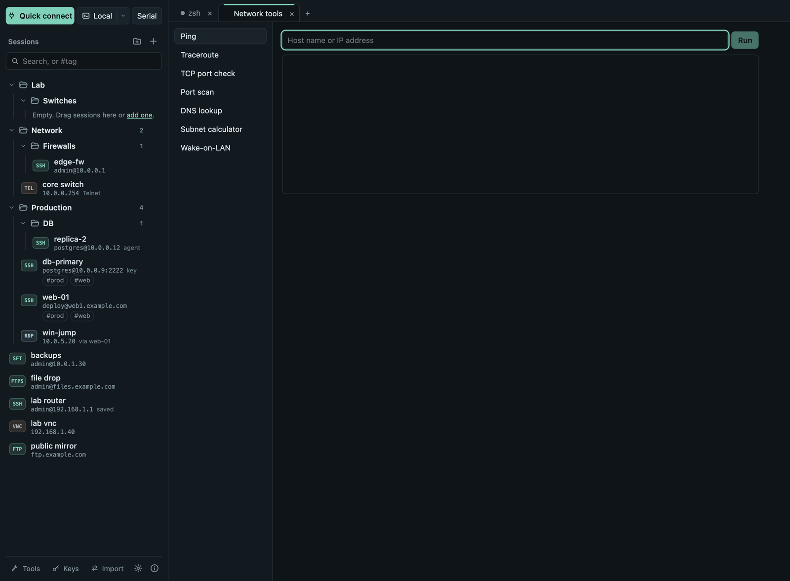

# Serial, Telnet and network tools

## Serial consoles

**Serial** at the top of the sidebar opens a console on a COM port (Windows)
or `/dev/tty…` device (macOS, Linux). Choose the port, speed, data bits,
parity, stop bits and flow control; 9600 8N1 is the usual setting for
network equipment. On Linux your user usually has to be in the `dialout`
group (`sudo usermod -aG dialout $USER`, then log in again).

## Telnet

For devices that offer nothing else, create a session of type **Telnet
(unencrypted)**. Everything you type, including passwords, can be read on
the network. Choose a jump host (**Connect via**) so that only the last leg,
from the jump host to the device, is unencrypted. Telnet can also go
through the proxy in [Settings](settings.md).

## Network tools

**Tools** in the sidebar footer:

| Tool | What it does |
|---|---|
| Ping | Round-trip times to a host. |
| Traceroute | The route to a host, hop by hop. |
| TCP port check | Whether one port on a host accepts connections. |
| Port scan | Open TCP ports on a host (up to 1024 ports, 64 at a time). Only scan hosts you are allowed to test. |
| Bandwidth (iperf3) | Measures throughput to an iperf3 server (`iperf3 -s` on the other side, port 5201): **Upload** (this computer sends) or **Download** (the server sends), 1–60 seconds, one TCP stream; a bar per second and the total. Works with standard iperf3 servers; nothing is installed. |
| LAN scan | Finds the hosts on a subnet (`192.168.1.0/24`, filled in with your own; /22 to /30) by trying common ports (SSH, Telnet, HTTP, HTTPS, SMB, RDP, VNC, 8080, 8443); a host that accepts or refuses a connection is listed with its open ports and, when the system knows it, its hardware (MAC) address. Hosts whose firewall drops everything stay hidden. Needs no administrator rights. |
| DNS lookup | The addresses a name resolves to. |
| Subnet calculator | Network, netmask, wildcard, broadcast and host range for an IPv4 address and prefix. |
| Wake-on-LAN | Sends a magic packet to a MAC address, optionally to a given broadcast address. |
| File servers (TFTP, HTTP, FTP) | Shares a folder of this computer, see below. |

## File servers (TFTP, HTTP, FTP)

**Tools → File servers (TFTP, HTTP, FTP)** shares one folder of this computer for
as long as you need it, for example to copy firmware or a configuration to a
switch over TFTP, to let a server fetch a file with `curl`, or to give an
older device or a file manager an FTP server.

- **Shared folder:** shown in full before you start. It is *Termalith
  Share* in your Downloads folder (marked *default*) until you click
  **Choose folder…** and pick another folder, or drop a folder onto the
  window while this tool is open. **Use default folder** goes back;
  **Open folder** shows the folder in Finder, Explorer or your file
  manager. Each running server shows the folder it shares.
- **Protocol and port:** TFTP on port 6969, HTTP on port 8080 or FTP on port
  2121 by default. Ports below 1024 (69 for TFTP, 80 for HTTP, 21 for FTP)
  need administrator rights on macOS and Linux; many devices let you give the port in the URL instead
  (`tftp://192.168.1.23:6969/file.bin`).
- **Allow other computers:** off by default, so only this computer can
  connect. Turn it on to serve devices on your network; the addresses to use
  are shown with each running server. Your firewall may ask to allow
  Termalith.
- **Login:** shown for every protocol before you start.
  - **FTP** always asks for a **User name** (default `termalith`; letters,
    digits, `.`, `_` and `-`) and a **Password**.
  - **HTTP** asks only if you turn on **Require a user name and password**
    (off by default, so devices that cannot sign in can still fetch files);
    clients then sign in with HTTP Basic, e.g. `curl -u user:password …`.
  - **TFTP** has no user name or password: the protocol does not support
    them. Anyone who can reach the port can read the files, so keep **Allow
    other computers** off unless you need it.

  Leave the password empty for a new random one; a chosen password needs at
  least 6 characters. Each running server shows its user name and password
  (**Copy**), or *none* when no login is asked. Anonymous sign-in is not
  offered.
- **Allow uploads:** off by default (read-only). When on, clients can upload
  new files and create folders (TFTP write, HTTP `PUT`, e.g. `curl -T
  backup.cfg http://192.168.1.23:8080/`, FTP `put`); an existing file is
  never replaced, and nothing is ever deleted or renamed.
- Each running server lists its addresses (**Copy**) and the recent
  requests: client, file, size and result. **Stop** ends it; servers also
  stop when Termalith quits.
- TFTP supports the block size, transfer size and timeout options; HTTP
  supports directory listings and byte ranges, FTP resumed downloads
  (`REST`). All three are unencrypted (FTP sends its password in plain
  text): share only what may be seen on the network, and only for
  as long as needed.
