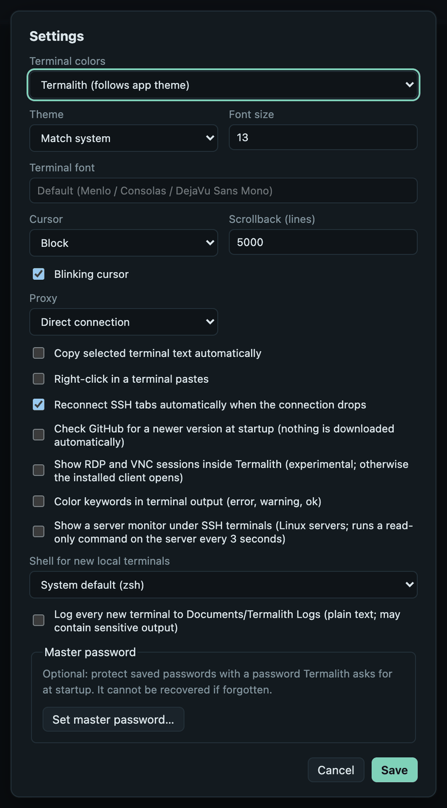

# Settings

Open **Settings** with ☀ in the sidebar footer. Changes apply when you click
**Save** (the master password section acts at once).

{ width="440" }

| Setting | What it does |
|---|---|
| **Terminal colors** | Color scheme for terminals: follows the app theme, or Solarized Dark/Light, Nord, Gruvbox Dark, Tomorrow Night. A session can override it ([per-session look](terminals.md#per-session-look)). |
| **Theme** | App theme: *Match system*, *Dark* or *Light*. |
| **Font size** | Terminal font size (8–32). |
| **Terminal font** | Any installed monospace font; empty uses Menlo (macOS), Consolas (Windows) or DejaVu Sans Mono (Linux). |
| **Cursor** | Block, bar or underline. |
| **Scrollback (lines)** | How many lines each terminal keeps (100–100,000). |
| **Blinking cursor** | Makes the cursor blink. |
| **Proxy** | *Direct connection*, *SOCKS5* or *HTTP (CONNECT)* for SSH and Telnet. Only the first hop uses it; FTP/FTPS refuse to connect while a proxy is set. |
| **Proxy host and port** | The proxy server (default port 1080 for SOCKS5, 3128 for HTTP). |
| **Proxy user name (optional)** and **Proxy password** | Login for the proxy (SOCKS5 user/password or HTTP Basic). The password is kept in the system keychain; *Forget the saved proxy password* removes it. HTTP proxies receive it in the clear. |
| **Copy selected terminal text automatically** | Selecting text copies it, like many Linux terminals. |
| **Right-click in a terminal pastes** | Right-click pastes instead of opening a menu. |
| **Warn before pasting several lines or risky text** | On by default. Shows the text first when it has several lines, ends with a line break, pipes a download into a shell, or contains invisible or control characters ([details](terminals.md#find-copy-and-links)). |
| **Reconnect SSH tabs automatically when the connection drops** | Reconnects after 5 seconds, with a Cancel button. |
| **Tell me when a new version is available** | On by default. At startup Termalith asks GitHub for the latest release; when it is newer, a small notice in the corner offers **Download** (opens the release page) or **Later** (that version is not shown again). Nothing is downloaded or installed automatically. Turn it off to make no request at all. |
| **Show RDP and VNC sessions inside Termalith** | Opens desktops in a tab instead of the installed client ([Remote desktop](remote-desktop.md)). |
| **Color keywords in terminal output** | Shows *error*, *warning*, *ok* and similar words in color. |
| **Show a server monitor under SSH terminals** | CPU, load, memory, disk and network of Linux servers, refreshed every 3 seconds. |
| **Shell for new local terminals** | Default shell for **Local** (shown when more than one is installed). |
| **Log every new terminal to Documents/Termalith Logs** | Writes every new terminal's output there as plain text. Logs may contain sensitive output. |
| **Master password** | Encrypts saved passwords with a password asked at startup; **Set**, **Change**, **Turn off** or **Lock now** ([details](passwords-and-data.md#master-password)). |
