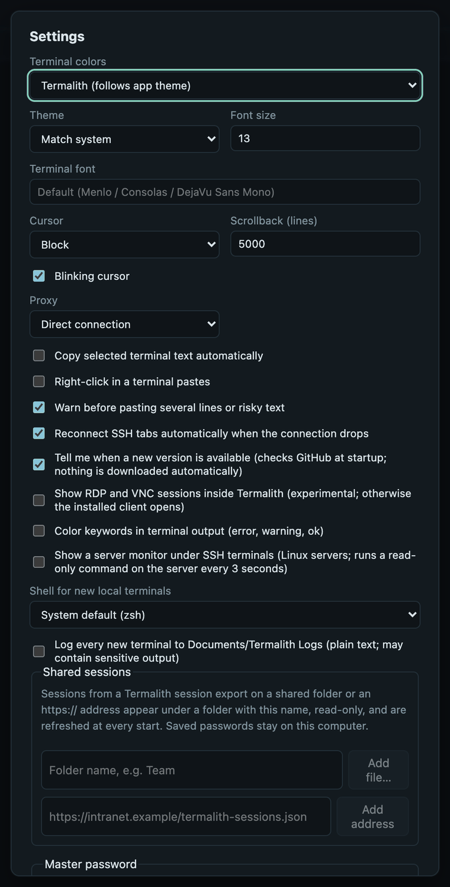

# Settings

Open **Settings** at the bottom of the rail on the left. The sections are
listed on the left; **Search settings** above them finds a setting by name
or by a word such as *clipboard* or *socks* (Enter opens the first match and
highlights it). Changes apply when you click **Save**; *Unsaved changes*
next to the buttons says when there are some. **Reset to defaults** puts
every setting back to its original value except the proxy and the default
shell, and it too only takes effect when you save. The master password and
shared sessions act at once.

{ width="640" }

## Appearance

A preview at the top shows terminal text with the chosen colors, font, line
height and cursor before you save.

| Setting | What it does |
|---|---|
| **Theme** | App theme: *System* (follows the computer), *Dark* or *Light*. |
| **Terminal colors** | Color scheme for terminals: follows the app theme, or Solarized Dark/Light, Nord, Gruvbox Dark, Tomorrow Night. A session can override it ([per-session look](terminals.md#per-session-look)). |
| **Terminal font** | Any installed monospace font (common ones are suggested); empty uses Menlo (macOS), Consolas (Windows) or DejaVu Sans Mono (Linux). |
| **Font size** | Terminal font size (8–32); − and + change it by one. The zoom shortcuts change it too. |
| **Line height** | Room between terminal lines: *Normal*, 110, 120, 130 or 150 %. |
| **Cursor shape** | Block, bar or underline. |
| **Blinking cursor** | Makes the cursor blink. |

## Terminal

| Setting | What it does |
|---|---|
| **Scrollback** | How many lines each terminal keeps (100–100,000). |
| **Shell for new local terminals** | Default shell for **Local** (shown when more than one is installed). |
| **Copy selected text automatically** | Selecting text in a terminal copies it, like many Linux terminals. |
| **Right-click pastes** | Right-click in a terminal pastes instead of opening a menu. |
| **Warn before risky pastes** | On by default. Shows the text first when it has several lines, ends with a line break, pipes a download into a shell, or contains invisible or control characters ([details](terminals.md#find-copy-and-links)). |
| **Ask before closing a connected tab** | Off by default. When on, closing a tab whose SSH, Telnet, serial, file or desktop connection is open (with ×, the tab menu or the shortcut) asks first. Local terminals and dropped connections close at once. |
| **Log every new terminal** | Writes every new terminal's output to *Documents/Termalith Logs* as plain text. Logs may contain sensitive output. |

## Keyword colors

| Setting | What it does |
|---|---|
| **Color keywords in terminal output** | Shows *error*, *warning*, *ok* and similar words in red, yellow and green. |
| **Red words** / **Yellow words** / **Green words** | Your own words for those colors, comma-separated (e.g. `err-disabled, down` in red, `up` in green). Whole words only (also next to a hyphen), up to 50 per color. The preview shows the colors. |

## Connections

| Setting | What it does |
|---|---|
| **Reconnect automatically** | When an SSH connection drops, Termalith reconnects after 5 seconds, with a Cancel button. |
| **Show RDP and VNC inside Termalith** | Experimental. Opens desktops in a tab instead of the installed client ([Remote desktop](remote-desktop.md)). |
| **Server monitor under SSH terminals** | CPU, load, memory, disk and network of Linux, macOS and FreeBSD servers, refreshed every 3 seconds by a read-only command. |

## Proxy

| Setting | What it does |
|---|---|
| **Proxy** | *Direct*, *SOCKS5* or *HTTP* (CONNECT) for SSH and Telnet. Only the first hop uses it; FTP/FTPS refuse to connect while a proxy is set. |
| **Host and port** | The proxy server (default port 1080 for SOCKS5, 3128 for HTTP). |
| **User name** and **Password** | Optional login for the proxy (SOCKS5 user/password or HTTP Basic). The password is kept in the system keychain; **Forget the saved proxy password** removes it. HTTP proxies receive it in the clear. |

## Security

| Setting | What it does |
|---|---|
| **Master password** | Encrypts saved passwords with a password asked at startup; **Set**, **Change**, **Turn off** or **Lock now** ([details](passwords-and-data.md#master-password)). Acts at once. |
| **Lock saved passwords after** | With a master password: after this long without keyboard or mouse use in Termalith, saved passwords lock until you enter it again (Never, 5, 15, 30 minutes, 1 or 4 hours). Open connections stay open. |

## Shared sessions

Session files shared by a team (a folder path or an `https://` address);
acts at once ([details](sessions.md#shared-session-files-team)).

## Updates

| Setting | What it does |
|---|---|
| **Tell me when a new version is available** | On by default. At startup Termalith asks GitHub for the latest release; when it is newer, a small notice in the corner offers **Download** (opens the release page) or **Later** (that version is not shown again). Nothing is downloaded or installed automatically. Turn it off to make no request at all. |

## Keyboard shortcuts

Lists the shortcuts that work everywhere in Termalith, with this computer's
keys: ⌘ on macOS, Ctrl+Shift on Windows and Linux (plain Ctrl+C, Ctrl+V and
Ctrl+W go to the program in the terminal).
