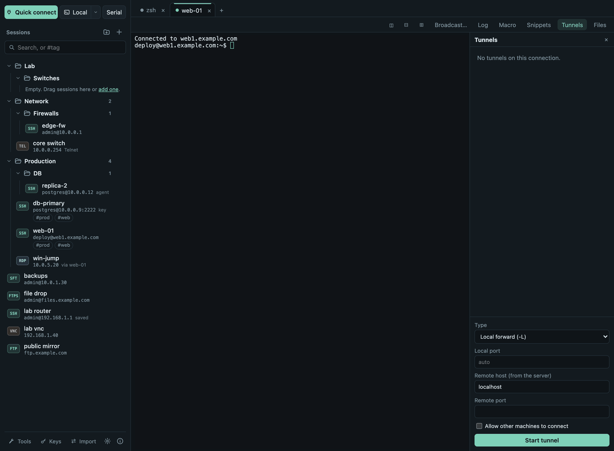
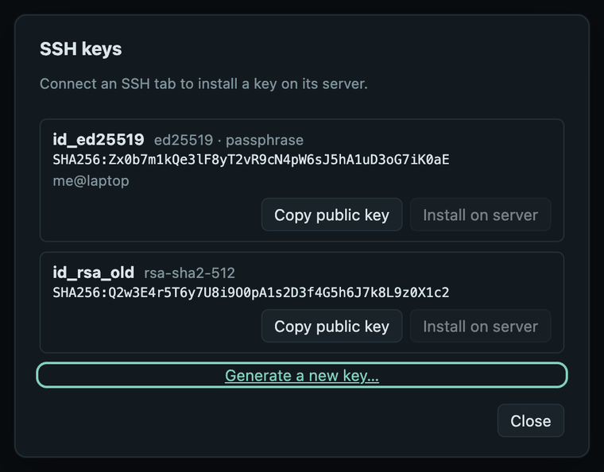

# SSH

## Logging in

Choose **Authentication** in the session dialog:

- **Password:** asked when you connect. Tick **Save in the system keychain**
  to store it; it is saved only after the login worked.
- **Private key file:** the full path to your key, e.g.
  `/Users/you/.ssh/id_ed25519`. If the key has a passphrase you are asked
  for it (and may save it).
- **SSH agent:** uses the keys loaded in your running `ssh-agent` (on
  Windows, the OpenSSH Authentication Agent service).

Servers that ask extra questions, such as a PAM password prompt or a
**one-time code** from an authenticator app, show them in a dialog. A
password you already entered is reused for a plain password prompt; codes
are always asked.

## Host keys

The first connection to a server shows its key fingerprint: **Trust and
connect** (remembered), **Connect once** or **Don't connect**. Keys you
already accepted in OpenSSH (`~/.ssh/known_hosts`) are trusted too.

If a server's key **changes**, Termalith refuses to connect and shows both
fingerprints. Only after the server's administrator confirms the change, use
**Remove recorded key…** and connect again.

## Jump hosts and proxies

- **Jump host:** in the session dialog choose **Connect via (jump host)**
  and another saved SSH session. Every hop's host key is checked. The jump
  host must log in without questions (a saved password, a key or the agent).
- **Proxy:** [Settings](settings.md) → *Proxy* sends SSH and Telnet
  connections through a SOCKS5 or HTTP CONNECT proxy, optionally with a user
  name and password (kept in the system keychain). Only the first hop goes
  through the proxy; the proxy sees which server you connect to but not the
  encrypted SSH traffic. HTTP proxies receive the password in the clear
  (Basic authentication), so use one you trust.

## Per-session options

- **Run after login:** one command typed into the shell when it is ready,
  e.g. `cd /var/log` or `tmux attach || tmux`.
- **Forward my SSH agent to this host:** the server may use your agent's
  keys while you are connected (for `git` or further SSH hops). Anyone with
  root on that server can use them too (not copy them), so enable it only
  for hosts you trust. Not applied to the jump host.
- **Forward X11:** graphical programs on the server open windows on your
  screen. You need a local X server: XQuartz on macOS, VcXsrv or Xming on
  Windows. The server receives only a random substitute cookie.
- **Files only (SFTP, no terminal):** connecting opens the file browser
  directly.
- **Appearance:** colors, font size and font for this session only; see
  [Terminals](terminals.md#per-session-look).

## Reconnect

If a connection drops (not when you type `exit`), the tab shows *Connection
lost. Reconnecting in 5 s…* with **Cancel**. Turn it off in
[Settings](settings.md) with *Reconnect SSH tabs automatically*.

## Tunnels

**Tunnels** on an SSH tab forwards ports through the connection:

| Type | Like | What it does |
|---|---|---|
| Local forward | `ssh -L` | A port on your computer reaches a host and port seen from the server, e.g. a database. |
| Remote forward | `ssh -R` | A port on the server reaches a host and port on your side. |
| SOCKS proxy | `ssh -D` | A SOCKS5 proxy on your computer whose connections leave through the server. |

Leave *Local port* on **auto** to get a free port. Tunnels listen on
`127.0.0.1` unless you tick *Allow other machines to connect* (for remote
forwards: *Listen on all server interfaces*). They close with the tab.

## Mosh

Tick **Connect with Mosh** for a session that survives network changes
(Wi-Fi to cable, sleep and wake). Termalith runs the **mosh** program
installed on your computer (macOS: `brew install mosh`; Linux: the `mosh`
package); the server needs `mosh-server`. Mosh signs in with your system's
`ssh` and its known hosts, in the terminal, so the password is typed there
and not saved. Jump hosts and forwarding are not available with Mosh.

## SSH keys

**Keys** in the sidebar footer:

{ width="440" }

- Lists the key pairs in your `~/.ssh` folder.
- **Generate a new key…** creates an Ed25519 key, optionally with a
  passphrase.
- **Copy public key** puts the public key on the clipboard.
- **Install on server** adds it to `~/.ssh/authorized_keys` on a server you
  are connected to; the folder and file get safe permissions and a key is
  never added twice.

## Server monitor

Turn on *Show a server monitor under SSH terminals* in
[Settings](settings.md) to see CPU, load, memory, the root disk and network
rate under the active SSH tab. It runs a read-only command on the server
every 3 seconds and works on Linux servers only; on others the bar says so.
