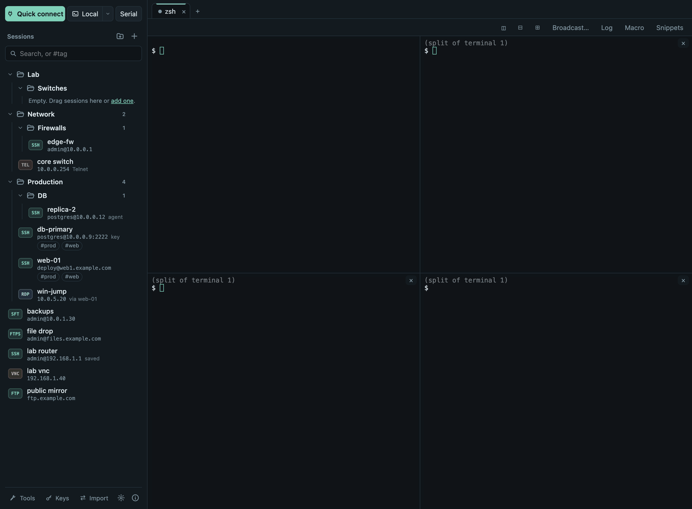
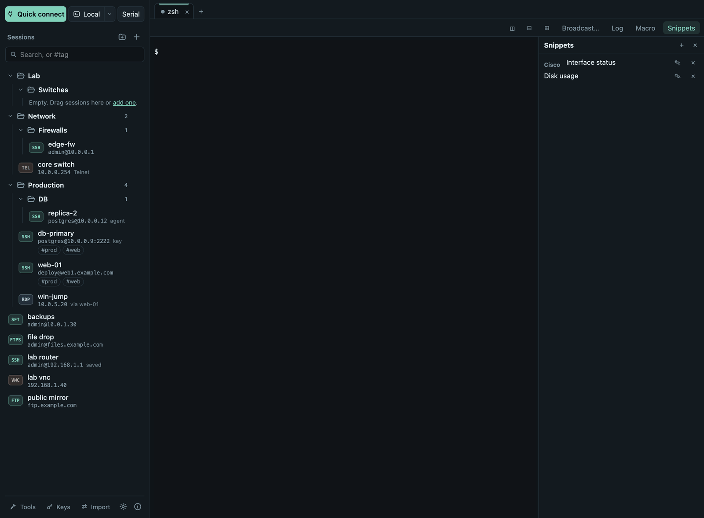

# Terminals

## Local terminals and shells

**Local** at the top of the sidebar opens a terminal on your computer; the
▾ next to it picks a shell (zsh, bash, fish…; on Windows PowerShell, cmd,
Git Bash and WSL distributions). Set the default in [Settings](settings.md)
→ *Shell for new local terminals*.

## Tabs

Every connection opens in a tab. Right-click a tab (or press
<kbd>Shift</kbd>+<kbd>F10</kbd>) to **rename**, **duplicate**, **save its
output** or close other tabs. <kbd>Cmd</kbd>/<kbd>Ctrl</kbd>+<kbd>K</kbd>
opens the **command palette**, which searches tabs, sessions and actions.
All shortcuts: [Keyboard shortcuts](shortcuts.md).

A small dot after a tab's title means new output arrived while you were in
another tab, e.g. a long command finished. It goes away when you open the tab.

## Split panes

The first three toolbar buttons split the tab **side by side**, **top and
bottom**, or into **four panes**:

SSH panes share the tab's connection, so splitting is instant and needs no
second login.

## Broadcast typing

**Broadcast…** types into several terminals at once, e.g. to run
`sudo apt update && sudo apt upgrade -y` on five servers by typing it once.
Pick the target terminals (**Select all** ticks every one); the source shows
a red banner and every target is marked, so you always know where your
keystrokes go. Type in the terminal with the red *BROADCASTING* banner.

- **A whole folder at once:** right-click a folder in the sidebar →
  **Open all and type into them at once…** opens its SSH and Telnet
  sessions and asks which of them to type into, all ticked. Terminals that
  are still connecting are listed as *connecting…* and receive what you type
  once they are connected.
- **Side by side:** tick **Show the terminals side by side** (on by default
  for a folder) to see the source and every target together, so you can
  watch each server's output. **Show as tabs** in the red banner switches
  back, **Show side by side** switches again.
- **Stop broadcast** on the source ends it; it also ends when the source
  tab closes or its connection ends.

## Snippets

**Snippets** keeps commands you use often. A snippet can contain
`{{variables}}`; when you run it you fill them in and see exactly what will
be typed, and choose whether to press <kbd>Enter</kbd>.

## Macros

**Macro** records what you type, including the pauses. Stop it, check the
recorded keys and give it a name; **▶** under *Macros* in the Snippets panel
plays it in the current terminal. Recording captures everything, passwords
included, and macros are stored unencrypted, so discard a recording if you
typed a password.

## Logs and saved output

- **Log** saves everything the tab shows as plain text in
  `Documents/Termalith Logs`. [Settings](settings.md) can log every new
  terminal automatically. Logs may contain sensitive output.
- **Save output…** in the tab menu saves what is on screen plus the
  scrollback.

## Find, copy and links

- <kbd>Cmd</kbd>+<kbd>F</kbd> (macOS) or <kbd>Ctrl</kbd>+<kbd>Shift</kbd>+<kbd>F</kbd>
  finds text in the scrollback.
- Copy and paste: <kbd>Cmd</kbd>+<kbd>C</kbd>/<kbd>V</kbd>, or
  <kbd>Ctrl</kbd>+<kbd>Shift</kbd>+<kbd>C</kbd>/<kbd>V</kbd>. Optional in
  [Settings](settings.md): copy on select, paste with a right-click.
- **Risky pastes are shown first.** Before pasting several lines (each runs
  as soon as it arrives), text ending in a line break, a download piped into
  a shell (`curl … | sh`), or invisible or control characters, Termalith
  shows the text and why it asks; **Paste** or **Cancel**. Invisible
  characters appear as `⟨U+200B⟩`. *Settings → Warn before pasting several
  lines or risky text* turns this off.
- <kbd>Cmd</kbd>/<kbd>Ctrl</kbd>+click opens an `http(s)` link in your
  browser.

## Colors, fonts and keyword colors

- [Settings](settings.md) chooses the terminal colors (Solarized Dark and
  Light, Nord, Gruvbox Dark, Tomorrow Night, or following the app theme), font, font size, cursor and
  scrollback.
- *Color keywords in terminal output* shows words such as *error*,
  *warning* and *ok* in color. Only the display changes: copied text and
  logs stay as they were, and full-screen programs are left alone.

## Per-session look

A session's **Appearance** (in the session dialog) can give it its own
colors, font size and font, so production servers stand out. Empty fields
follow Settings. Works for SSH and Telnet sessions.
